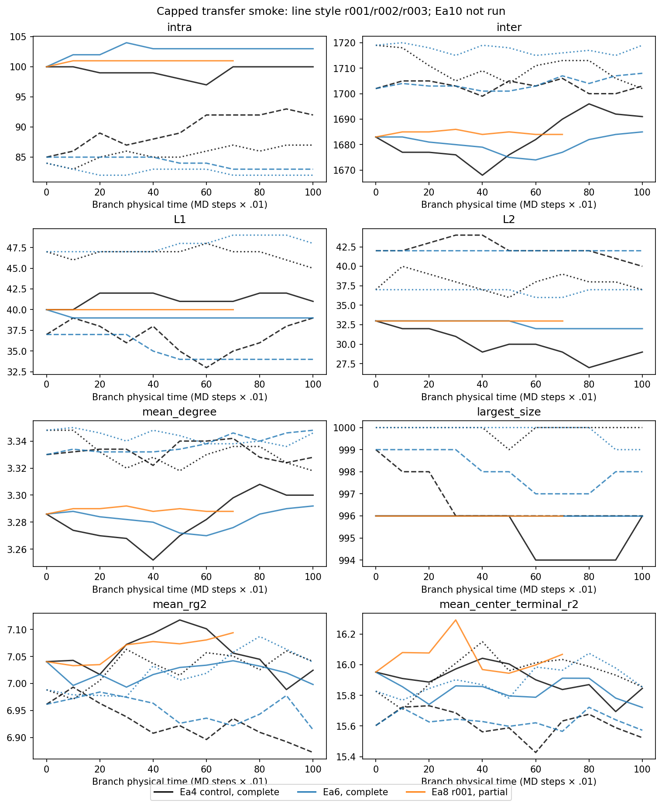

# Ea reference-transfer GPU smoke: failed

**Decision: smoke failed. Do not advance to the kinetic screen.** The Ea8 r001
history terminated on `candidate regression: oracle count mismatch`. The established
launcher stopped, preserving its incomplete receipt. Ea8 r002/r003 and all Ea10
histories were not executed. No gate was bypassed, no failed attempt was reused,
and no simulation, candidate search, oracle or frozen physics source was changed.

Starting local/remote clean `KremerGrest` SHA:
`2f961789c1bb18bba13f911cf7687222595f7649`. Date: 2026-10-16.
All plans bind that SHA and the authenticated out-of-tree build from
`523f49be292d32c48ad216103b126341ba337159`.

## Per-history outcomes

All histories were planned from the corresponding exact qualified corrected-C1
8M parent, with branch age zero and end cap 8,010,000. All twelve host preflights,
parent authentications, fresh-stream checks and plan-bound approvals passed.

| Ea | Replica | Result | Additional steps | Creations / breaks | Neighbor gains / losses |
|---|---|---|---:|---:|---:|
| 4 | r001 | Numerically validated | 10,000 | 195 / 187 | 180 / 173 |
| 4 | r002 | Numerically validated | 10,000 | 182 / 174 | 154 / 155 |
| 4 | r003 | Numerically validated | 10,000 | 153 / 167 | 135 / 150 |
| 6 | r001 | Numerically validated | 10,000 | 33 / 28 | 29 / 26 |
| 6 | r002 | Numerically validated | 10,000 | 31 / 27 | 31 / 22 |
| 6 | r003 | Numerically validated | 10,000 | 22 / 24 | 17 / 18 |
| 8 | r001 | Candidate-oracle failure | 7,100 inferred | 5 / 3 | 4 / 3 |
| 8 | r002 | Not executed | 0 | — | — |
| 8 | r003 | Not executed | 0 | — | — |
| 10 | r001 | Not executed | 0 | — | — |
| 10 | r002 | Not executed | 0 | — | — |
| 10 | r003 | Not executed | 0 | — | — |

Six validated completions account for 60,000 MD steps. The failed history last
passed its oracle at 8,007,000 and last wrote diagnostics there. The next chemistry
sweep at 8,007,100 throws before `kinetics.update`; this places the inferred stop
at 7,100 branch steps, or **67,100 aggregate steps**. There is no final-step receipt
for that history. Independently of this inference, only seven histories started,
so the cap gives a rigorous aggregate upper bound of 70,000, below the authorized
120,000. No history exceeded 10,000. The five unstarted replica directories are empty.

## Failure and CPU counterexample

The candidate search subtracts float position components before promoting the
displacement to double (`kg_assoc_star_runtime.cuh:285`); the independent oracle
promotes each component before subtraction (`kg_assoc_candidate_oracle.cuh:20`).
The host-only [counterexample](cutoff_counterexample.cu) calls both unchanged
implementations with x=-0.1f and x=1.15f, y=z=0, box=40, cutoff=1.25.
Candidate displacement is 1.25 and the strict cutoff excludes it; oracle displacement
is 1.2499999776482582 and includes it. Found count=0, expected count=1.
The same count-mismatch exception is reproduced without GPU initialization.

This establishes an arithmetic discrepancy, **not the identity or cause of the
actual failing GPU pair**. The failing coordinates and candidate-set difference
were not emitted. A cell-neighbor omission or another discrepancy is not excluded.
Neither implementation was changed, and no tolerance or gate was relaxed.

## Initial-state fidelity and numerical checks

All twelve host checks authenticate the old/new chemical seed, target Ea, inherited
partners/counters and the unchanged loader representation, including particle/type/
molecule IDs, permanent bonds, box, PBC-folded positions and velocities. Paired
host fingerprints agree across barriers for each parent. All seven launched
initial diagnostics match the parent populations; the six complete histories also
pass the full endpoint and event validator, exact particle/molecule/permanent-bond
identity checks, chemical reciprocity, counter conservation and effective MD-seed
checks. Runtime T=1, dt=.01 and friction=.5 are authenticated in their logs.

The six completed histories provide 600 successful candidate-oracle sweeps, testing
all-pairs enumeration, ordered unique pairs and distances, including active pairs
within r_assoc. The failed history adds 70 successful sweeps before the mismatch.
Finite sampled temperatures range 0.971683–0.988464, permanent distances
0.839943–1.170445 < R0=1.5; all final temporary FENE states and finite velocities
pass validation for the six completions. Partial diagnostics are valid through
8,007,000; there is no final snapshot/sidecar for the failed history.

The restart loader copies stored positions/velocities, and GJ is constructed with
initVelocities=false. Initial conformation and kinetic temperature agree with
parent snapshot calculations at the established serialization tolerances. However,
the executable does **not** emit an independent full per-particle GPU readback
before its first MD step. Exact device-coordinate/velocity identity is therefore
supported by source/state flow and aggregate checks, rather than independently
measured for every particle. Add that diagnostic to a future validation; do not
present host fingerprints as a device-memory measurement. GJ internal state and
MD noise reset: all branches are explicitly non-bitwise continuations.

## Kinetic observations and uncertainty

Here q(Ea) = -expm1(-20 exp(-Ea)) for T=1, Nevery=100, dt=.01.
The exact conditional probability factors relative to Ea4 are:

| Ea | q | q/q4 |
|---|---:|---:|
| 4 | 0.3067140771 | 1 |
| 6 | 0.0483662585 | 0.1576916813 |
| 8 | 0.006686795774 | 0.02180139835 |
| 10 | 0.0009075864893 | 0.002959063691 |

Event-integrated exposures below retain all initial events. Between consecutive
accepted events B(t) is constant; integrate B dt and (4000−2B) dt, assigning zero
duration to same-step events. This is exact population accounting in recorded
physical time, not a frame-sampled approximation.

| Ea | Replica | Bond × time | Free sticker × time | Breaks / time | Neighbor losses / time |
|---|---|---:|---:|---:|---:|
| 4 | r001 | 178110 | 43780 | 1.87 | 1.73 |
| 4 | r002 | 179296 | 41408 | 1.74 | 1.55 |
| 4 | r003 | 179630 | 40740 | 1.67 | 1.50 |
| 6 | r001 | 178280 | 43440 | 0.28 | 0.26 |
| 6 | r002 | 178760 | 42480 | 0.27 | 0.22 |
| 6 | r003 | 179975 | 40050 | 0.24 | 0.18 |

Formation rates per physical time are Ea4: 1.95/1.82/1.53 and Ea6:
.33/.31/.22, in replica order. Distinct-neighbor gains are 1.80/1.54/1.35 and
.29/.31/.17. Rates per bond-time/free-sticker-time, eligible-active and nonactive geometric
candidate counts and conditional Poisson counting intervals are in RESULTS.json.
Nonactive geometric pairs include unavailable occupied partners; their counts
are not eligible formation opportunities. The counting intervals are descriptive; correlated
network events need not be Poisson and these intervals do not represent preparation uncertainty.

Using each parent control break hazard and q scaling predicts 29.52/27.36/26.39
Ea6 breaks versus 28/27/24 observed. The ratios observed/conditional prediction
are .949/.987/.910 (three-parent mean .948, between-parent SEM .022). This is
consistent with the approximate short-run kinetic expectation, not a formal
equivalence or equilibrium test. Energies, eligible geometry, competing updates
and recrossings change with time: a full sweep is not a uniform clock rescaling.

The failed Ea8 partial path has five creations, three breaks, four neighbor gains
and three losses. Exposure to the inferred failure time is 126,776 bond×time and
30,448 free-sticker×time. The corresponding r001 control-scaled break expectation is about 2.90,
versus three observed. It is censored by an oracle error and has no validated
endpoint; do not pool it with completed histories. No Ea10 activity was measured.
Zero Ea10 events in a successful short run would be permissible; unexecuted
histories cannot be represented as zero-event observations.

## Network, conformation and control interpretation

[NETWORK_AND_SHAPE.csv](NETWORK_AND_SHAPE.csv) gives initial/final values for
each completion and labels the failed history’s last observed sample separately.
RESULTS.json includes complete multiplicity 0–4 distributions, degree/loop
distributions, isolated-star identities and component sizes. L1 and degree changes
are algebraically related to bond multiplicity and are not independent evidence.

For Ea4 r001/r002/r003, bonds change +8/+8/−14; intra loops 0/+7/+3; L1
+1/+2/−2; L2 −4/−2/0; degree +.014/−.002/−.030. Giant sizes change
996→996, 999→996, 1000→1000. Ea6 bond changes are +5/+4/−2, intra
+3/−2/−2, L1 −1/−3/+1, L2 −1/0/0; giant sizes 996→996, 999→998,
1000→999. These short fluctuations do not establish peripheral-state mixing.

Ea4 control initial Rg² is 7.040507/6.961489/6.988360 and final values are
7.024596/6.872324/7.040954. Center-terminal R² changes 15.951795→15.845755,
15.603110→15.523969, 15.827428→15.855174. Ea6 final Rg² is
6.998184/6.914277/7.039526 and center-terminal R² 15.721300/15.572560/15.854872.
The first recorded control shapes (1,000 steps after restart) show changes below
1% relative to their corresponding initial values, with no resolved aggregate
loading jump. The cadence is too coarse to exclude a first-step discontinuity.

The three parent families remain the independent preparation units; barriers
are paired descendants. Frames, events and six completions do not increase this
count. No IAT, structural mixing or stationarity claim is made from 100 time units.
All reference qualifications, possible initialization bias, incomplete slow-topology
sampling and historical executable-authentication limitations carry forward.

## Smallest corrective next step

1. Investigate the confirmed cutoff-arithmetic discrepancy with this CPU fixture,
   the frozen implementation and the LAMMPS reference semantics. Decide the correct
   numerical contract before proposing a search/oracle change; this review changes neither.
2. Add test-only failure diagnostics that save actual/expected set differences,
   near-cutoff distances and failing sticker coordinates, plus an initial
   per-particle device readback assertion. Cover them with CPU tests.
3. Obtain separate authorization for a capped diagnostic retest after that review,
   using the established planner/approval gates, fresh immutable reservations and
   preserved failed evidence. Do not reuse failed output paths or reclaim these
   claimed streams. Only after a complete smoke passes consider a kinetic screen.

No further GPU calculation, kinetic screen, acceptance, registry action or
production preparation is authorized or performed. See [EXECUTION.md](EXECUTION.md)
and [VALIDATION.md](VALIDATION.md) for exact identities, receipts and reproduction.
