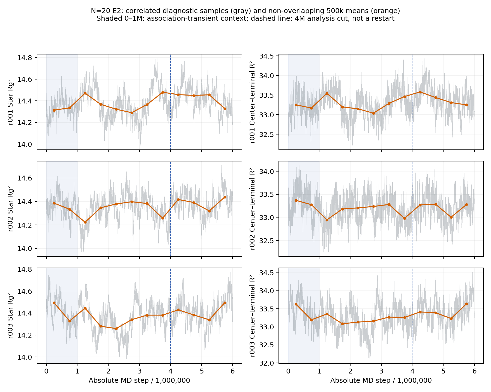

# f=4, N=20 joint E2 assessment through 6M

**Recommendation: qualified acceptance of the exact three authenticated 6M endpoints for production initialization only.** No additional E2 checkpoint is recommended on the present evidence. This recommendation is not formal registration, active endpoint selection or production authorization; registration requires separate explicit user approval.

The primary 4–6M minus 2–4M conformation shift is real finite-window evidence: Rg² +0.055446 ± 0.042850 (about 0.39%) and center–terminal R² +0.135935 ± 0.227433 (about 0.41%), with all three changes positive. It is not dismissed because of its size or uncertainty. However, later and shifted comparisons lose that common direction: 4–5M to 5–6M ensemble changes are −0.025511 ± 0.089298 and −0.111115 ± 0.330559, with r001/r002 contracting and r003 slightly expanding. Late slopes have mixed signs, and the full histories show bounded excursions, not persistent common expansion. This supports a slow-fluctuation interpretation in the late preparation regime, without proving a unique stationary conformational distribution.

Bulk chemistry, degree moments and exchange remain approximately prepared. Small common connectivity and late intra/inter changes do remain; these are qualifications, not silently declared stationary. The recommendation rests on the complete paths, nonmonotonic reversals, stable total populations and materially small bulk changes together, not on confidence intervals containing zero. No universal percentage threshold, significance gate or complete decorrelation requirement is imposed. The available evidence does not establish sustained material chemical, conformational or global network relaxation that requires further E2 before qualified initialization.

## Authentication and independent units

Starting verified local/remote `KremerGrest`: `05d6ea06323df2b0059fa1da9c1fb21d56f75e0e`. Source plan SHA256: `085a6a56f004ef6c5d21d2d0fa0a9277e51e8c97c96312eaf34e2067de5e5b90`. Frozen E1 states/completions/diagnostics, plans/approval, replica seeds, physical parameters, builds/logs/sources, current executable bytes, completion receipts and all endpoint payloads authenticate. Three histories pass fresh numerical, accepted-event/network and conformation validation. They are continuous 0–6M runs with no E2 extension or intermediate MD reseed; 2M/4M cuts are analysis boundaries only. Chemistry seeds are 420901/420902/420903 and MD seeds 520070/520071/520072. T=1, dt=0.01, Ea=4, Ee=8, f=4, N=20 and frozen polymer bead density 0.8 are unchanged.

Only the three original histories are independent units. Paired intervals use Student-t df=2 (the established helper rounds its 95% critical value to 4.303); the tiny difference from the preliminary terminal-R² half-width is rounding, not a data discrepancy. Stars, correlated frames, time blocks and overlapping windows are not extra replicas. IAT/SEM/block diagnostics are computed within each chosen continuous window. The 0–1M unbound association transient is preserved as context, not retroactively certified stationary. See [VALIDATION.md](VALIDATION.md) and [provenance.json](provenance.json).

## Complete non-overlapping 1M means

Rates are accepted events per MD time unit. L1 counts parallel inter-star bond pairs; L2 counts distinct-star triangles. Neighbor degree is distinct inter-star neighbors. Satellites are non-singleton components outside one largest component. Conformations use the existing stable-ID, permanent-bond minimum-image unwrapping.

| Observable | 0–1M context | 1–2M | 2–3M | 3–4M | 4–5M | 5–6M |
|---|---:|---:|---:|---:|---:|---:|
| L1 | 26.016 | 27.542667 | 28.256333 | 25.974333 | 24.295333 | 27.434 |
| L2 | 22.100333 | 23.882333 | 21.701333 | 23.445 | 20.643667 | 23.437 |
| bonds | 1705.1067 | 1713.0063 | 1713.3373 | 1715.3183 | 1714.3403 | 1714.5863 |
| bound_fraction | 0.85255333 | 0.85650317 | 0.85666867 | 0.85765917 | 0.85717017 | 0.85729317 |
| components | 4.7116667 | 3.3806667 | 3.0826667 | 2.7856667 | 2.9673333 | 3.3883333 |
| degree_0_fraction | 0.003094 | 0.002221 | 0.0019303333 | 0.001672 | 0.0017926667 | 0.002188 |
| degree_1_fraction | 0.03067 | 0.028116 | 0.027992 | 0.027280333 | 0.028534 | 0.027726667 |
| degree_2_fraction | 0.148563 | 0.14794067 | 0.14562933 | 0.14634767 | 0.145137 | 0.144065 |
| degree_3_fraction | 0.36556067 | 0.36551733 | 0.370522 | 0.36591433 | 0.364336 | 0.367642 |
| degree_4_fraction | 0.45211233 | 0.456205 | 0.45392633 | 0.45878567 | 0.46020033 | 0.45837833 |
| free | 589.78667 | 573.98733 | 573.32533 | 569.36333 | 571.31933 | 570.82733 |
| inter | 1642.36 | 1649.982 | 1651.3197 | 1652.2797 | 1650.4833 | 1653.4963 |
| intra | 62.746667 | 63.024333 | 62.017667 | 63.038667 | 63.857 | 61.09 |
| isolated_stars | 3.094 | 2.221 | 1.9303333 | 1.672 | 1.7926667 | 2.188 |
| largest_cluster_fraction | 0.995 | 0.99744833 | 0.99775233 | 0.998085 | 0.99784867 | 0.997373 |
| mean_center_terminal_r2 | 33.314866 | 33.21849 | 33.153329 | 33.25632 | 33.396317 | 33.285202 |
| mean_degree | 3.2329273 | 3.2453693 | 3.246522 | 3.2528613 | 3.2526173 | 3.252296 |
| mean_rg2 | 14.364818 | 14.355305 | 14.331151 | 14.374635 | 14.421095 | 14.395584 |
| satellite_components | 0.61766667 | 0.15966667 | 0.15233333 | 0.11366667 | 0.17466667 | 0.20033333 |
| satellite_stars | 1.906 | 0.33066667 | 0.31733333 | 0.243 | 0.35866667 | 0.439 |
| second_degree_moment | 11.148765 | 11.208815 | 11.208029 | 11.246471 | 11.251311 | 11.246818 |
| breaks | 1.7397667 | 1.7408 | 1.7375 | 1.7323667 | 1.7388 | 1.7403 |
| creations | 1.9109 | 1.7402667 | 1.7380333 | 1.7315 | 1.7406 | 1.7376667 |
| neighbor_gains | 1.7850333 | 1.6232667 | 1.6186667 | 1.6158333 | 1.6274 | 1.6203333 |
| neighbor_losses | 1.6228 | 1.6237333 | 1.6188667 | 1.6162667 | 1.6250333 | 1.6226667 |

The full replica/window/correlation evidence is in [joint6m/summary.json](joint6m/summary.json).

## Detailed conformational paths

Gray lines are correlated scalar diagnostic samples, orange lines uniform 500k means. They carry no pseudo-replica uncertainty bars. The dashed 4M line is not a restart.

| History / shape | 0–1M | 1–2M | 2–3M | 3–4M | 4–5M | 5–6M |
|---|---:|---:|---:|---:|---:|---:|
| r001 mean_rg2 | 14.324454 | 14.41916 | 14.306464 | 14.422918 | 14.453514 | 14.392173 |
| r001 mean_center_terminal_r2 | 33.210474 | 33.371373 | 33.094044 | 33.375424 | 33.508957 | 33.279508 |
| r002 mean_rg2 | 14.359707 | 14.28477 | 14.38799 | 14.320262 | 14.404001 | 14.37826 |
| r002 mean_center_terminal_r2 | 33.322314 | 33.064266 | 33.220916 | 33.128865 | 33.278207 | 33.141395 |
| r003 mean_rg2 | 14.410294 | 14.361985 | 14.299 | 14.380726 | 14.40577 | 14.416317 |
| r003 mean_center_terminal_r2 | 33.411812 | 33.219832 | 33.145028 | 33.264671 | 33.401788 | 33.434705 |

| Shape | Early → late interval | r001 / r002 / r003 changes | Mean ± exploratory 95% half-width |
|---|---|---|---:|
| mean_rg2 | 2–4M → 4–6M | +0.05815265 / +0.03700465 / +0.07118053 | +0.05544594 ± 0.04284977 |
| mean_center_terminal_r2 | 2–4M → 4–6M | +0.1594979 / +0.03491017 / +0.2133968 | +0.135935 ± 0.2274328 |
| mean_rg2 | 4–5M → 5–6M | -0.06134047 / -0.02574028 / +0.01054735 | -0.02551113 ± 0.08929819 |
| mean_center_terminal_r2 | 4–5M → 5–6M | -0.2294489 / -0.136812 / +0.03291692 | -0.1111147 ± 0.3305592 |
| mean_rg2 | 3–4M → 5–6M | -0.03074477 / +0.05799813 / +0.03559097 | +0.02094811 ± 0.1146472 |
| mean_center_terminal_r2 | 3–4M → 5–6M | -0.09591659 / +0.01252936 / +0.1700339 | +0.02888223 ± 0.3322237 |
| mean_rg2 | 3–5M → 4–6M | -0.01537238 / +0.02899907 / +0.01779548 | +0.01047406 ± 0.05732359 |
| mean_center_terminal_r2 | 3–5M → 4–6M | -0.04795829 / +0.006264681 / +0.08501696 | +0.01444112 ± 0.1661119 |
| mean_rg2 | 2.5–4.5M → 3.5–5.5M | +0.06206375 / -0.0173815 / +0.000171604 | +0.01495128 ± 0.1036811 |
| mean_center_terminal_r2 | 2.5–4.5M → 3.5–5.5M | +0.1048909 / -0.05681594 / +0.04796253 | +0.0320125 ± 0.2037775 |
| mean_rg2 | 3–4.5M → 4.5–6M | -0.0229734 / +0.03020659 / +0.008277909 | +0.005170368 ± 0.06639603 |
| mean_center_terminal_r2 | 3–4.5M → 4.5–6M | -0.1111914 / +0.01333857 / +0.1064699 | +0.002872348 ± 0.2713082 |
| mean_rg2 | 3.5–5M → 4.5–6M | -0.0507305 / +0.02731385 / +0.007618673 | -0.005265993 ± 0.1008299 |
| mean_center_terminal_r2 | 3.5–5M → 4.5–6M | -0.1607517 / +0.01133943 / +0.06595873 | -0.02781784 ± 0.2939443 |
| mean_rg2 | 4.5–5M → 5.5–6M | -0.1209116 / +0.04587678 / +0.1119379 | +0.01230103 ± 0.2981229 |
| mean_center_terminal_r2 | 4.5–5M → 5.5–6M | -0.1885241 / -0.006277717 / +0.2483519 | +0.01785003 ± 0.5451511 |

All seven alternate conformational comparisons have mixed replica directions for both shapes; positive primary expansion is not invariant to shifting the comparator. Some alternate ensemble changes remain positive, so this is not a claim of zero drift. The overlapping contrasts are correlated sensitivity checks, not independent confirmations. r001 has a broad late peak followed by contraction; r002 remains bounded around repeated peaks/dips; r003 recovers from an earlier dip and has a latest upward excursion, within its earlier range. The primary effect is compatible with these differently phased slow excursions.

## Primary paired 4–6M minus 2–4M changes

| Observable | r001 / r002 / r003 changes | Mean ± 95% half-width |
|---|---|---:|
| bonds | +2.7555 / -0.4675 / -1.8815 | +0.1355 ± 5.904237 |
| bound_fraction | +0.00137775 / -0.00023375 / -0.00094075 | +6.775e-05 ± 0.002952119 |
| free | -5.511 / +0.935 / +3.763 | -0.271 ± 11.80847 |
| intra | -3.236 / +7.0215 / -3.9495 | -0.05466667 ± 15.25015 |
| inter | +5.9915 / -7.489 / +2.068 | +0.1901667 ± 17.22556 |
| largest_cluster_fraction | -1.6e-05 / -0.00063 / -0.0002775 | -0.0003078333 ± 0.0007654789 |
| mean_degree | +0.012183 / -0.013489 / +0.009601 | +0.002765 ± 0.03511725 |
| L1 | -0.049 / -0.9775 / -2.7255 | -1.250667 ± 3.376213 |
| L2 | -2.081 / -0.59 / +1.0725 | -0.5328333 ± 3.919111 |
| components | -0.036 / +0.676 / +0.091 | +0.2436667 ± 0.9434479 |
| second_degree_moment | +0.071237 / -0.067414 / +0.061622 | +0.021815 ± 0.1923474 |
| mean_rg2 | +0.05815265 / +0.03700465 / +0.07118053 | +0.05544594 ± 0.04284977 |
| mean_center_terminal_r2 | +0.1594979 / +0.03491017 / +0.2133968 | +0.135935 ± 0.2274328 |
| isolated_stars | -0.0595 / +0.702 / -0.075 | +0.1891667 ± 1.103529 |
| satellite_components | +0.0235 / -0.026 / +0.166 | +0.0545 ± 0.2476469 |
| satellite_stars | +0.0755 / -0.072 / +0.3525 | +0.1186667 ± 0.5354172 |
| degree_0_fraction | -5.95e-05 / +0.000702 / -7.5e-05 | +0.0001891667 ± 0.001103529 |
| degree_1_fraction | -0.0008305 / +0.0022195 / +9.35e-05 | +0.0004941667 ± 0.003885449 |
| degree_2_fraction | -0.0041735 / +0.002634 / -0.002623 | -0.0013875 ± 0.008864027 |
| degree_3_fraction | -0.0011065 / -0.0012455 / -0.0043355 | -0.002229167 ± 0.004535064 |
| degree_4_fraction | +0.00617 / -0.00431 / +0.00694 | +0.002933333 ± 0.01561336 |
| creations | -0.00615 / +0.0149 / +0.00435 | +0.004366667 ± 0.02614768 |
| breaks | -0.00575 / +0.0163 / +0.0033 | +0.004616667 ± 0.02753593 |
| neighbor_gains | +0.00255 / +0.00975 / +0.00755 | +0.006616667 ± 0.009166277 |
| neighbor_losses | +0.00285 / +0.00975 / +0.00625 | +0.006283333 ± 0.008571267 |

Bond population is 1714.328 → 1714.463 and bound fraction 0.857164 → 0.857232. Intra/inter means are 62.528 → 62.474 / 1651.800 → 1651.990, with opposite replica repartitioning. Creation and rupture rates remain approximately 1.74 per time unit, neighbor gains/losses 1.62. Neighbor turnover increases slightly in all primary histories (gains +0.00662, losses +0.00628; about 0.4%). Activity establishes accepted renewal, not full structural mixing.

L1 decreases in all primary histories (−1.251 ± 3.376), but its 1M sequence 28.256 → 25.974 → 24.295 → 27.434 reverses in the latest interval, with positive 4–5M to 5–6M changes in all three histories. L2 has mixed primary changes and a nonmonotonic path 21.701 → 23.445 → 20.644 → 23.437. Mean degree 3.24969 → 3.25246 and second moment 11.22725 → 11.24906 have mixed replica changes. No coherent continuing motif or degree-moment relaxation is established.

## Residual connectivity and intra/inter qualifications

The giant fraction decreases in all primary histories: −0.000307833 ± 0.000765479, equivalent to 0.308 additional stars outside the giant among 1000. This direction persists in most shifted contrasts, and some exploratory intervals exclude zero. It is **not** dismissed as nonsignificant. Total components increase +0.24367 ± 0.94345; satellite components +0.0545 ± 0.24765, satellite stars +0.11867 ± 0.53542 have mixed primary signs and rare, heterogeneous populations. Isolation changes are dominated by r002.

| Network observable | 3–4M → 5–6M | 3–4.5M → 4.5–6M | 4–5M → 5–6M |
|---|---:|---:|---:|
| largest_cluster_fraction | -0.000712 ± 0.0007093601 | -0.0003875556 ± 0.0003064748 | -0.0004756667 ± 0.001069035 |
| components | +0.6026667 ± 1.067024 | +0.3035556 ± 0.4997146 | +0.421 ± 0.8151015 |
| isolated_stars | +0.516 ± 1.336359 | +0.2368889 ± 0.6614757 | +0.3953333 ± 0.6424901 |
| satellite_components | +0.08666667 ± 0.2826619 | +0.06666667 ± 0.1793624 | +0.02566667 ± 0.2035389 |
| satellite_stars | +0.196 ± 0.63278 | +0.1506667 ± 0.3719803 | +0.08033333 ± 0.5006193 |
| intra | -1.948667 ± 18.82095 | -1.834 ± 5.719657 | -2.767 ± 7.253184 |
| L1 | +1.459667 ± 2.755063 | +1.49 ± 3.816876 | +3.138667 ± 6.225523 |
| L2 | -0.008 ± 8.694831 | +0.3206667 ± 8.185951 | +2.793333 ± 4.647094 |

The full 1M connectivity trajectory rises after association and then falls modestly after its 3–4M peak; the latest giant fraction is close to the 1–2M contextual value, not outside its earlier range. In every replica, 5–5.5M is a lower giant-fraction excursion followed by recovery in 5.5–6M. Ensemble giant fractions are 0.997718 → 0.997979 → 0.997198 → 0.997548 in the last four 500k windows. Satellite counts/masses do not show a common persistent trend: r002 decreases while r003 increases, and r001 peaks then returns. The common connectivity effect deserves qualification; a weak ongoing peripheral redistribution cannot be excluded. At its observed absolute scale, with bounded paths, stable bulk connectivity/degree moments and ongoing exchange, it does not demonstrate a material preparation failure. This is a scientific judgment for initialization, not a universal small-fraction acceptance threshold.

Intra populations decrease in the late 4–6M slopes in all histories (effective samples only ~9–11). The latest 500k has a shared dip: ensemble intra means 64.659 → 63.055 → 66.504 → 55.676; inter rises in the last bin while total bonds remain near their late preparation range. The 4–5M to 5–6M intra contrast is −2.767 ± 7.253, and 4.5–5M to 5.5–6M is −7.379 ± 9.647 with all three changes negative. This late repartitioning is retained as a qualification, not asserted stationary. The full 1M/2M ensemble intra means are otherwise bounded, with mixed primary/shifted changes; one late dip does not establish sustained common equilibration. Connectivity, isolation and satellite identities are coupled and are not independent confirmations.

## Late segment-local IAT and blocking

4–6M duration is 20000 MD time units. IAT estimates use the existing first-nonpositive-lag heuristic. Slopes below are descriptive per MD time unit, not independently weighted significance tests.

| History / mode | IAT | Effective samples | Within-window slope | SEM with 5 / 10 / 20 blocks |
|---|---:|---:|---:|---|
| r001 mean_rg2 | 691.1382 | 14.46889 | -6.166101e-06 | 0.02595673 / 0.02202877 / 0.01986178 |
| r001 mean_center_terminal_r2 | 655.0875 | 15.26514 | -1.868014e-05 | 0.06708157 / 0.06134454 / 0.05134011 |
| r001 intra | 1120.973 | 8.92082 | -0.0003559534 | 2.743872 / 2.294049 / 1.770314 |
| r001 L1 | 710.7657 | 14.06933 | -8.08162e-05 | 0.8063524 / 1.231593 / 0.9693116 |
| r001 L2 | 1373.246 | 7.282018 | +0.0004132722 | 1.699608 / 1.176211 / 0.9150897 |
| r001 satellite_components | 98.66816 | 101.3498 | +4.625551e-06 | 0.03629738 / 0.03977716 / 0.0334664 |
| r001 satellite_stars | 102.0655 | 97.97629 | +1.242998e-05 | 0.0896779 / 0.09752621 / 0.08295362 |
| r001 isolated_stars | 122.0423 | 81.93881 | +4.458204e-05 | 0.1823139 / 0.1464837 / 0.1347424 |
| r002 mean_rg2 | 573.8908 | 17.42492 | -1.907052e-07 | 0.02408637 / 0.0206212 / 0.0152969 |
| r002 mean_center_terminal_r2 | 497.9808 | 20.0811 | -4.343385e-06 | 0.06571359 / 0.04928887 / 0.03918624 |
| r002 intra | 1153.958 | 8.665823 | -0.0007121617 | 3.675078 / 2.998949 / 2.189442 |
| r002 L1 | 1647.777 | 6.068783 | +0.0007583289 | 2.275187 / 1.635577 / 1.234995 |
| r002 L2 | 324.9822 | 30.77092 | +0.0001364748 | 0.7633996 / 0.6913534 / 0.6344837 |
| r002 satellite_components | 79.82706 | 125.2708 | -2.068876e-06 | 0.02540423 / 0.0269057 / 0.03123995 |
| r002 satellite_stars | 79.35379 | 126.0179 | -5.137951e-06 | 0.05800539 / 0.05800958 / 0.06492141 |
| r002 isolated_stars | 262.9688 | 38.02733 | -2.169826e-06 | 0.2043994 / 0.2143375 / 0.1882108 |
| r003 mean_rg2 | 702.3131 | 14.23866 | +4.551411e-06 | 0.02877998 / 0.02581234 / 0.01934839 |
| r003 mean_center_terminal_r2 | 463.8627 | 21.5581 | +1.395581e-05 | 0.07539701 / 0.06907587 / 0.05475173 |
| r003 intra | 912.2948 | 10.96137 | -0.0005603734 | 2.75176 / 2.189003 / 1.759042 |
| r003 L1 | 833.5659 | 11.99665 | +0.0001702011 | 1.528808 / 1.142084 / 0.9741621 |
| r003 L2 | 770.4783 | 12.97895 | +0.0005128186 | 1.697158 / 1.253277 / 0.9780222 |
| r003 satellite_components | 140.853 | 70.99603 | +3.537301e-06 | 0.07638144 / 0.06765435 / 0.06613145 |
| r003 satellite_stars | 126.3506 | 79.14488 | +9.713552e-06 | 0.1539411 / 0.1360041 / 0.1361199 |
| r003 isolated_stars | 156.4364 | 63.92375 | -5.161801e-06 | 0.07052482 / 0.1613261 / 0.142272 |

Conformation effective samples are only about 14–22; 20-block errors are often smaller than 5-block errors because short blocks can remain correlated. Slow network modes are even less resolved: r001 L2 ~7.3, r002 L1 ~6.1, intra ~8.7–11. The heuristic can miss long tails, and blocking does not establish an asymptotic error plateau. Stationary-mean errors are conditional on the window being approximately stationary; they cannot by themselves distinguish weak drift from slow fluctuations. All 1M/2M and additional conformational interval details are preserved in the JSON evidence. No IAT, SEM or blocking error is pooled from separate windows, and no time block becomes an independent replica.

## Arm-length context: corrected accepted N=10 reference

Only formally accepted corrected C1 8M states and corrected 6–8M window statistics are used. Historical PBC-defective windows remain ineligible and are excluded from these means. [arm_length_context.json](arm_length_context.json) binds the frozen C1 summary and accepted payloads.

At 1000 stars and polymer bead density 0.8, N=10 has 41000 polymer beads and volume 51250; N=20 has 81000 and volume 101250. N=20 star/sticker densities are 41/81 ≈ 0.50617 of N=10. This changes contact opportunities and network populations along with arm length; the comparison is not an isolated arm-length perturbation at fixed sticker density. Total bead density, f, Ee and Ea remain fixed.

Corrected N=10 means: bonds 1794.005, bound fraction 0.897003, intra 95.454, inter 1698.551, mean degree 3.31856, L1 39.6457, L2 33.3938, giant fraction 0.997694. N=20 has lower association/motif populations, with a similarly dominant giant. These are physical geometry/contact-density differences consistent with the protocol, not values N=20 must match to be equilibrated.

Accepted N=10 endpoint Rg² values are approximately 7.0405/6.9615/6.9884, center–terminal R² 15.9518/15.6031/15.8274. N=20 late means are ~14.4083 and ~33.3408, showing the larger arm geometry. C1 time-resolved conformations are unavailable in that historical review; this endpoint-only comparison cannot provide a comparative stationarity or relaxation-time test. Longer-arm modes warrant caution, but no unmeasured relaxation scaling law is used as an acceptance criterion.

## Exact proposed endpoints and next decision

The endpoints are the predeclared absolute **6,000,000** checkpoints, not states selected for favorable observables.

- r001: `examples/KG_Assoc/kg_assoc_100m/banks/e2_attempts/F04_N020_RP080_EE08/equilibrate_bdfe5dc30d87435899f6d2d21dc99fac/r001/state`; chemistry/MD/effective MD seeds `420901/520070/3951175424`.
  - Restart SHA256: `290af8505bd3fe5b39b391fc9bd5ddffa5b9229ef36930d1c89e0cc5a3a5618f`.
  - Chemical sidecar SHA256: `a871ff27c1f9af22a4c534b6542e2287f9d0ad61973c91a8d2fa583c16f09406`.

- r002: `examples/KG_Assoc/kg_assoc_100m/banks/e2_attempts/F04_N020_RP080_EE08/equilibrate_bdfe5dc30d87435899f6d2d21dc99fac/r002/state`; chemistry/MD/effective MD seeds `420902/520071/3942807296`.
  - Restart SHA256: `d74f5e21323b5989693a300046fdeb98ca463cc2032cae43f18ad25d3fa49752`.
  - Chemical sidecar SHA256: `2c8ba79d5431c1b7d7dad0a1d22541777434aa6950f165886794525cb2513265`.

- r003: `examples/KG_Assoc/kg_assoc_100m/banks/e2_attempts/F04_N020_RP080_EE08/equilibrate_bdfe5dc30d87435899f6d2d21dc99fac/r003/state`; chemistry/MD/effective MD seeds `420903/520072/3833972496`.
  - Restart SHA256: `21677b64503c4447c00c2d428c3d98d87d423cfc4c6e3ff19c8a41d32c6d2e3b`.
  - Chemical sidecar SHA256: `5ebda1164d8345debcb02a4c35a3b3aaf24e9c6a699d6c9542514cf339a19553`.

**Next decision required:** explicit user approval to register qualified formal scientific acceptance of exactly these three 6M states for production initialization only, retaining the qualifications above. No additional E2 trajectory is recommended or authorized here. Registry activation and production authorization would be separate subsequent decisions. The five accepted systems remain unchanged.

Fresh 500k means reproduce every available original checkpoint metric/rate within 1e-10. Original checkpoint receipt/report hashes authenticate unchanged. Numerical validation is separate from this documented scientific recommendation and from formal acceptance/production authorization.
