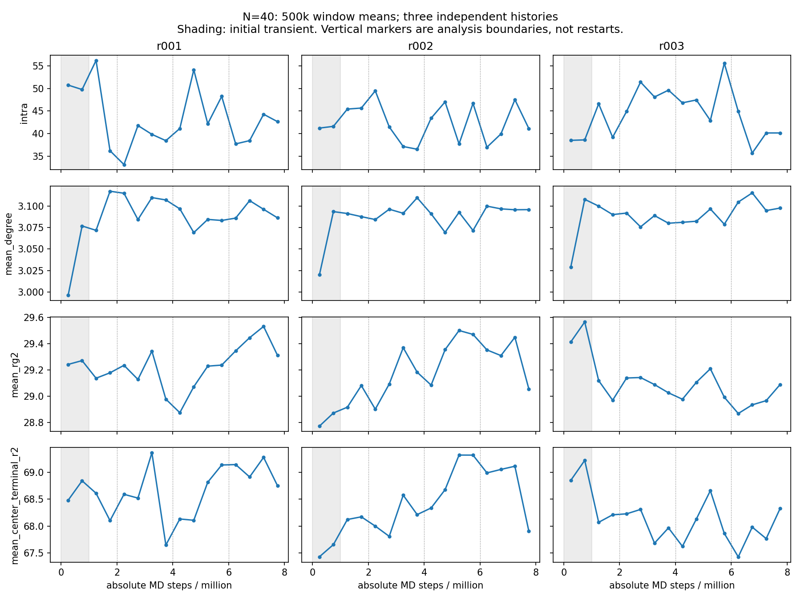

# f=4, N=40 joint E2 assessment through 8M

**Recommendation: qualified acceptance of the exact three authenticated absolute 8M endpoints for production initialization only.** Additional E2 is not recommended on the present combined evidence. This is a documented scientific recommendation, not formal acceptance registration, active endpoint selection or production authorization. Separate explicit user approval is required for registration.

The coherent primary intra/inter and degree changes are genuine finite-window evidence. They are not dismissed because some exploratory intervals include zero. The complete history shows a 4–6M coordination trough, recovery toward earlier values in 6–8M, and a reversal within the last 2M. Slow fluctuations are a reasonable interpretation; a weak continuing redistribution cannot be excluded. Full topological or conformational stationarity is not demonstrated.

## Authentication and scope

Local and remote starting HEAD: `0d947d7c17e8e9e7b48e726a50206d5b041e2287`.
Plan SHA256: `c8d624d6205f3b5eeb926b66fa9f992a446e9d53b4840cc88c8240406b99044c`.
All three original E1 → E2 histories independently pass fresh numerical, accepted-event, network, restart and conformation validation. Current E2 executable/build bytes and scientifically relevant source hashes authenticate. E1 states and surviving completion/diagnostic provenance are frozen and authenticated; historical E1 executable bytes are not reauthenticated. [VALIDATION.md](VALIDATION.md) and [provenance.json](provenance.json) record the precise scope.

These are continuous 0–8M histories, initially unbound, with no intermediate E2 restart or MD reseeding. 2M/4M/6M markers are analysis cuts. The first 0–1M interval is association-transient context; 0–2M is excluded from candidate long-window comparisons. Three histories are the independent units throughout. Paired intervals use Student-t df=2, are exploratory and unadjusted. Windows, stars, frames, blocks and coupled graph observables are not additional independent evidence.

## Intra/inter repartitioning and neighbor coordination

| Three-history mean | 2–4M | 4–6M | 6–8M |
|---|---:|---:|---:|
| Total bonds | 1608.3007 | 1606.0317 | 1606.7720 |
| Intra-star bonds | 42.6430 | 46.0932 | 40.7780 |
| Inter-star bonds | 1565.6577 | 1559.9385 | 1565.9940 |
| Distinct-neighbor degree | 3.094608 | 3.083150 | 3.098007 |
| Second degree moment | 10.307438 | 10.252979 | 10.332559 |
| L1 | 18.3800 | 18.4600 | 17.0920 |
| L2 | 14.4195 | 13.8707 | 14.3267 |

The primary 6–8M minus 4–6M changes reproduce the preliminary checkpoint:

- Intra: −5.31517 ± 7.05429; replica changes −5.6490/−2.3235/−7.9730.
- Inter: +6.05550 ± 6.70656; +2.9545/+7.3315/+7.8805.
- Distinct degree: +0.0148573 ± 0.0102614, positive in all three histories (~0.48% of the earlier mean).
- Second moment: +0.0795793 ± 0.0541987, positive in all histories (~0.78%).

These are one coupled network redistribution, not four independent confirmations. More inter-star bonds and fewer parallel inter-star connections can raise distinct-neighbor coordination. L1 counts pairs of parallel inter-star bonds; L2 counts distinct-star triangles, not graph cycle rank.

The preceding 2–4M→4–6M contrast points in the opposite ensemble direction: intra +3.45017 ± 10.67456, inter −5.71917 ± 12.23323, degree −0.011458 ± 0.027086. Comparing 2–4M directly with 6–8M gives intra −1.865 ± 14.12252, inter +0.33633 ± 18.25522 and degree +0.0033993 ± 0.036599, all with mixed replica changes. Thus the primary comparison partly measures recovery from an intermediate trough; the broad histories do not establish a common monotonic partition drift.

Within the last 2M, 7–8M minus 6–7M gives intra +3.69333 ± 8.31562 (two positive, one nearly unchanged), inter −3.38667 ± 8.27011 and degree −0.0070813 ± 0.0147133 (all three negative), and second moment −0.0383507 ± 0.095908 (all negative). All three late fitted inter/degree slopes also point downward. The last-vs-earlier 500k intra contrast (7.5–8M versus 6.5–7M) is positive in all histories: +3.274 ± 4.51181. A unidirectional continuing intra→inter conversion is not supported through the final checkpoint.

Shifted comparisons are not uniformly neutral: 4.5–6.5M→5.5–7.5M inter +3.90867 ± 2.33325 and degree +0.0091997 ± 0.0065603 retain positive changes in all histories; 5–6.5M→6.5–8M degree +0.0096442 ± 0.0046732 does too. These correlated contrasts retain the trough-to-recovery effect and prevent a claim of a precisely stationary partition. Intra changes have mixed signs in these shifted comparisons. The full sensitivity evidence is retained, including intervals that exclude zero.

Degree distributions corroborate the same coupled effect: primary degree-1 and degree-2 fractions fall by 0.001426 and 0.006153; degree-4 rises by 0.004963. The latest 1M degree-1 fraction rises in every history, while degree-4 changes have mixed signs. No common sustained movement to higher coordination is established. L1 declines by −1.368 ± 2.053 in the primary comparison but rebounds in all histories in the late 500k contrast (+2.55267 ± 2.89893); L2 has mixed primary changes (+0.456 ± 3.87443). Motif stationarity is qualified, not proven.

## Peripheral connectivity: a remaining coherent qualification

Giant fractions are 0.9959803 → 0.9956442 → 0.9958465 and total components 4.6567 → 4.9707 → 4.7187 in successive 2M comparisons. Primary giant/component changes have mixed replica signs. Isolation returns to the earlier ensemble level: 3.3543 → 3.6478 → 3.3510 stars, with heterogeneous replica paths.

Rare non-singleton satellites show a more persistent ensemble increase:

| Observable | 2–4M | 4–6M | 6–8M | 6–8M minus 2–4M (95% half-width) |
|---|---:|---:|---:|---:|
| Satellite components | 0.302333 | 0.322833 | 0.367667 | +0.065333 ± 0.051760 |
| Satellite stars | 0.665333 | 0.708000 | 0.802500 | +0.137167 ± 0.135757 |

Both broad contrasts are positive in all histories and their exploratory intervals narrowly exclude zero. These are approximately 22% and 21% relative increases; **their relative size is not dismissed**. They remain evidence of possible peripheral-connectivity redistribution. The primary 4–6M→6–8M satellite component changes are +0.005/+0.1055/+0.024; satellite-star changes −0.038/+0.242/+0.0795, concentrated in r002 rather than a uniform growth path.

The late paths fluctuate: satellite-star 6–7M→7–8M changes are −0.135/+0.438/+0.378. In the final two 500k windows satellite-star means decline in every history: 0.602→0.600, 1.178→1.088, 1.068→0.960. Satellite-component means decrease in r002/r003 and are almost unchanged in r001. Reasonable shifted contrasts have mixed component/mass directions, except some broader ones remain positive. This supports bounded rare excursions but does not determine their stationary distribution or exclude weak relaxation.

At the observed absolute scale (about 0.14 extra satellite stars among 1000 between early/late 2M means), without a sustained common giant-component, isolation or bulk coordination drift, this residual does not demonstrate a material failure of production initialization. This is a qualified scientific judgment from the combined paths, not a universal threshold or an assertion that satellite-specific observables are already equilibrated. Rare satellite statistics and isolation/degree redistribution must remain explicit limitations. The giant fraction also has a small common late 500k decrease (−0.000572 ± 0.000671), another peripheral qualification rather than an independently confirming graph result.

## Conformations and slow sampling

Rg² 2M means are 29.13663 → 29.17680 → 29.22259; center–terminal R² 68.24243 → 68.51130 → 68.55509. Ensemble increases do not represent a shared sustained replica drift. Primary Rg² changes are +0.30504/−0.06099/−0.10669, mean +0.045787 ± 0.560659; terminal changes +0.47427/−0.14896/−0.19393, mean +0.043791 ± 0.927849. All shifted shape contrasts have mixed replica directions. The latest 1M comparison is Rg² +0.024413 ± 0.254887 and terminal R² −0.061435 ± 1.070671, again mixed.

r001 expands after its 3–4M dip, then contracts in the final 500k; r002 peaks around 5–6M and contracts sharply late; r003 recovers from its 6–7M dip. These are differently phased slow excursions. The relatively high late r001 and low r003 means show limited between-history overlap, not a precisely equilibrated conformational distribution.

In 6–8M, Rg² IATs are ~714/1098/648 MD time units with effective samples ~14.0/9.1/15.4; terminal IATs ~541/949/752, effective samples ~18.5/10.5/13.3. Intra is slower: ~799/1429/890, effective samples ~12.5/7.0/11.2. L1/L2 effective samples are ~13.6–26.4/~19.1–22.4. Degree and inter modes have about 29–51/33–51 effective samples. These heuristic counts describe conditional sampling, not additional independent histories or proof of decorrelation.

5/10/20-block errors are not uniformly stable. For r002 Rg², SEM is 0.0893/0.0658/0.0490; intra 1.903/1.509/1.142. Twenty blocks span only 1000 MD time units, shorter than r002 intra IAT and comparable to its shape IAT. Conversely r001 inter error rises from 0.566 (5 blocks) to 1.833 (20), reflecting uneven slow paths. No asymptotic blocking plateau is demonstrated. First-nonpositive-lag IATs may underestimate long tails, and stationary-mean errors cannot distinguish weak drift from slow excursions by themselves. Full interval-specific diagnostics, including shifted windows and descriptive slopes, are in [window_sensitivity.json](window_sensitivity.json) and [EVIDENCE.md](EVIDENCE.md).

## Turnover and arm-length context

The late bound fraction is 0.803386. Bond creation/rupture and distinct-neighbor gain/loss remain active and nearly balanced (roughly 1.62 and 1.55 events per MD time unit, respectively). The exact rates, exposures, replica changes and temporal uncertainties are recorded in the evidence. Active turnover establishes ongoing renewal, not full structural equilibration.

Authenticated accepted N=20 4–6M means have bonds ~1714.46, intra ~62.47, degree ~3.25246, L1/L2 ~25.86/22.04, giant ~0.99761, Rg² ~14.4083 and terminal R² ~33.3408. Corrected accepted N=10 means have bonds ~1794.01, intra ~95.45, degree ~3.31856, L1/L2 ~39.65/33.39, giant ~0.99769. Only corrected C1 evidence is used; historical PBC-defective C1 is excluded. Its shapes are endpoint-only (~7.0/~15.8), so no comparative conformation-stationarity inference is possible.

With 1000 stars and rho_p=0.8, N=10/20/40 polymer bead counts are 41000/81000/161000 and volumes 51250/101250/201250. N=40 star/sticker densities are 81/161 ≈0.5031 of N=20 and 41/161 ≈0.2547 of N=10. Lower association/coordination/motif populations and larger conformational sizes are physical context for the changed geometry/contact density, not values N=40 must match to qualify. Arm length is not varied at fixed star or sticker density. [arm_length_context.json](arm_length_context.json) binds the reference evidence and preserves its historical provenance limitations.

## Qualifications and next decision

The exact predeclared 8M endpoints are recommended, not selected for favorable instantaneous observables. Qualifications: unproven full slow topology/conformational decorrelation; modest effective conformation/intra sampling; coupled late partition/degree redistribution with reversal and remaining shifted effects; coherent but rare satellite-population increase with uncertain stationary distribution; small late giant/isolation/degree changes; only three independent histories and exploratory uncertainty. Current E2 bytes authenticate; the historical E1 and corrected C1 context have the explicitly narrower authentication scopes above.

**Next decision requiring approval:** whether to register qualified formal scientific acceptance of exactly the three 8M endpoints below for `production_initial_state` only, retaining these limitations. Registration, registry activation and production authorization are separate actions. None is performed here. The six existing formal acceptances remain unchanged. No additional E2 trajectory is recommended or authorized by this review.

## Exact proposed endpoints

- r001: `examples/KG_Assoc/kg_assoc_100m/banks/e2_attempts/F04_N040_RP080_EE08/equilibrate_0a6a37a1e8264ceabbeead5362d8423d/r001/state` — absolute step **8,000,000**; chemistry/MD/effective seeds `421001/520076/3867477776`.
  - Restart SHA256: `f4cb793093a304fde9068be8639e68bc2fd384c1b4320e6b734a5f320b295978`.
  - Chemical sidecar SHA256: `2d361153e9ba53845ab3a6dd77e1b7d575b51dd2c760f5c4b1806e6a6394aaab`.

- r002: `examples/KG_Assoc/kg_assoc_100m/banks/e2_attempts/F04_N040_RP080_EE08/equilibrate_0a6a37a1e8264ceabbeead5362d8423d/r002/state` — absolute step **8,000,000**; chemistry/MD/effective seeds `421002/520077/3859109648`.
  - Restart SHA256: `e034ac5e50215aef8f492a7625ab7dabee904f1d240413ec2b216c40e7159ac2`.
  - Chemical sidecar SHA256: `0b7e1fa370a773f2dcd802dada3bb70e3bff03568642ec0a1a93ec92fea1ef9a`.

- r003: `examples/KG_Assoc/kg_assoc_100m/banks/e2_attempts/F04_N040_RP080_EE08/equilibrate_0a6a37a1e8264ceabbeead5362d8423d/r003/state` — absolute step **8,000,000**; chemistry/MD/effective seeds `421003/520078/3884230416`.
  - Restart SHA256: `d7a1b4965b3ad7ce56a8b512eeb25b58059d4aa983e985be2b3bdd7e0bffaa78`.
  - Chemical sidecar SHA256: `5005e92b2fb0730978841228b0f986fff4e2a507ba35eb01cfa982b2218b1563`.

All 816 shared 500k checkpoint means reproduce within 2.23e-16. Original data, checkpoint/workflow records and six acceptances authenticate unchanged. Numerical validity, this recommendation, formal acceptance and production authorization remain distinct.
